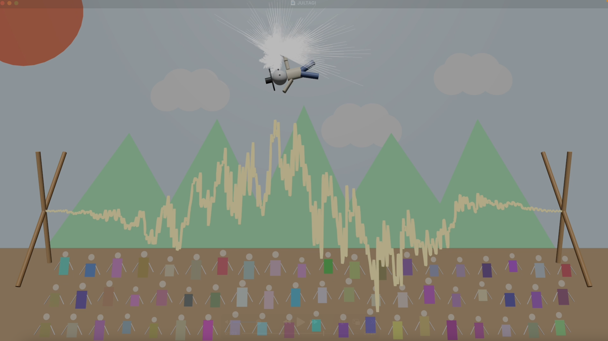

# JULTAGI (줄타기)



[Watch Demo on YOUTUBE](https://youtu.be/yBSrb2m3r5o)

## About JULTAGI

Jultagi is a traditional Korean tightrope-walking performance that combines acrobatics, music, and audience interaction. Performers often use a fan while balancing on the rope. This project reimagines Jultagi through real-time audio visualization and interactive sound.

## Audio Visualization

The tightrope represents the audio waveform, while the fan displays the frequency spectrum and its history. The fan opens when the sound level exceeds a threshold and closes when it falls below it.

The audience responds to the music by bouncing according to its loudness. Each audience member has a different random phase, so they move at different times.

## Sound Design

The performance begins with a melody played by the Nabal, a traditional Korean wind instrument.

The percussion section uses samples of three traditional Korean instruments: Jing, Kkwaenggwari, and Janggu. I created an algorithm that combines fixed and randomized rhythmic patterns, generating a different musical performance each time. The tempo also changes throughout the piece.

I also used six Chuimsae samples. Chuimsae are vocal expressions used by audiences and performers to encourage and respond to traditional Korean music. In this project, the player can trigger Chuimsae by pressing the spacebar, adding their own responses to the music.

## Instructions

To run the project, open Terminal in the project folder and run both ChucK files together (ChucK with ChuGL is required):

```sh
chuck music.ck jultagi.ck
```

- **Left / Right Arrow Keys:** Move the tightrope guy left and right.
- **Spacebar:** While the guy is in the air, hold the spacebar to spin. Each new press also plays one of six randomly selected Chuimsae samples.

## Sound Sources

All sound samples were obtained from the [National Gugak Center's Digital Sound Library](https://www.gugak.go.kr/digitaleum/front/monotone/list.do).
